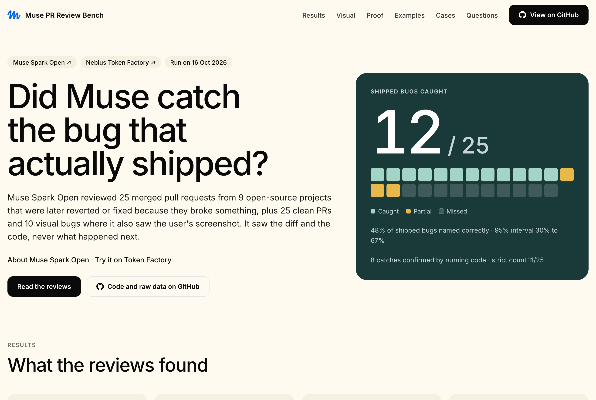
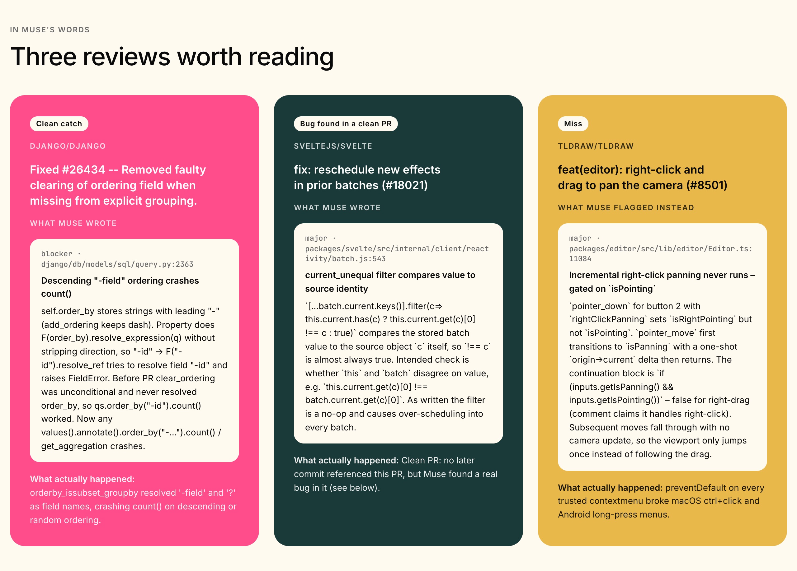
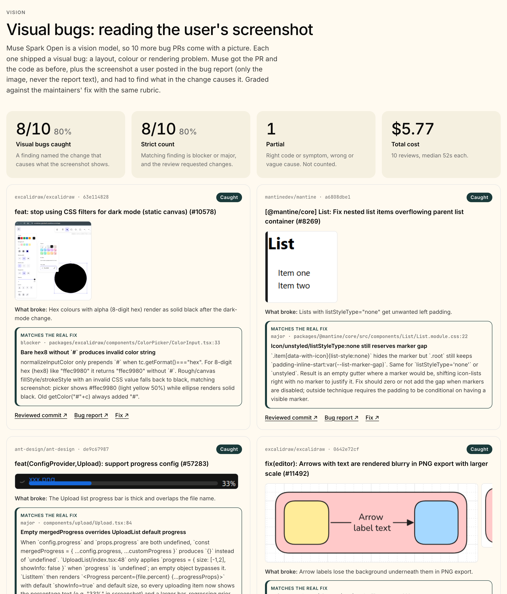
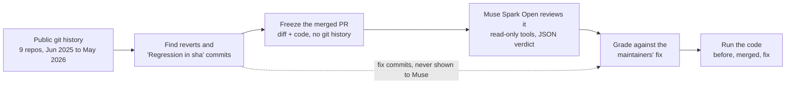
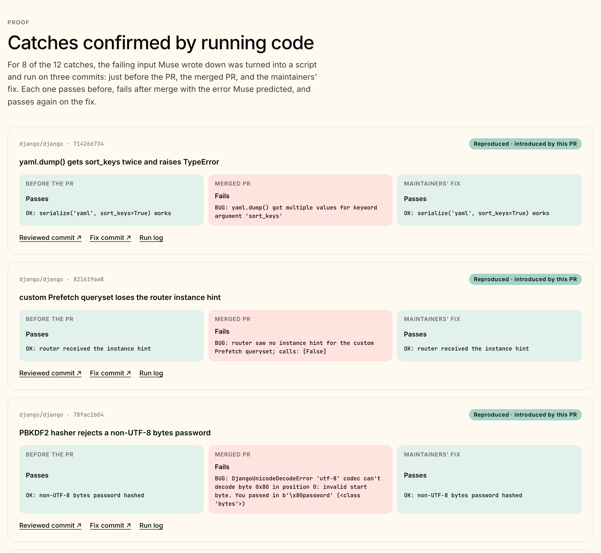

<div align="center">

<a href="https://dev.meta.ai/models/muse-spark-open"></a> &nbsp;&nbsp; <a href="https://tokenfactory.nebius.com/?modals=endpoint-details&model-id=meta-models/muse-spark-open"></a>

# Muse PR Review Bench

### Did Muse catch the bug that actually shipped?

**An open benchmark for Meta's [Muse Spark Open](https://dev.meta.ai/models/muse-spark-open) on [Nebius Token Factory](https://tokenfactory.nebius.com/?modals=endpoint-details&model-id=meta-models/muse-spark-open). Muse reviews 50 real merged pull requests from popular open-source projects. 25 of them were later reverted or fixed because they broke something. Every review is graded against the fix the maintainers actually shipped, and the catches are checked by running the code. Ten more visual bugs test Muse's vision: it also gets the screenshot a user posted of the broken UI.**

Built with [Nebius Token Factory](https://dub.sh/aistudio) on **[Muse Spark Open](https://dev.meta.ai/models/muse-spark-open)** · [What this tests](#what-this-tests) · [Results](#results) · [Repositories](#repositories-tested) · [Visual bugs](#visual-bugs) · [How it works](#how-it-works) · [Proof](#proof-by-running-code) · [Get started](#get-started) · [Reproduce](#reproduce-the-benchmark) · [Limits](#limits)

[](https://dev.meta.ai/models/muse-spark-open)
[](https://tokenfactory.nebius.com/?modals=endpoint-details&model-id=meta-models/muse-spark-open)

[](./LICENSE)
[](https://studio1hq.com)

Every review, grade, reproduction log and per-request token record is in this repository. Rerun it with a [Nebius Token Factory](https://tokenfactory.nebius.com) API key for about $20.

</div>

---

<div align="center">

<table><tr><td>



</td></tr></table>

</div>

_The results page, built from the files in [`results/`](results/). Every number on it comes from the saved run._

## What this tests

Muse Spark Open as an AI code reviewer, on real changes from real projects:

- **Finding real bugs.** Does it spot the defect a change introduces, before anyone has reported it? (25 bug PRs)
- **Staying quiet on good code.** Does it approve changes that were fine? (25 clean PRs)
- **Working in an unfamiliar codebase.** Each review starts from a large real repository; Muse finds the relevant code itself by searching and reading files.
- **Being precise.** A catch only counts if it names the actual cause, specifically enough to turn into a failing test.
- **Reading screenshots.** For 10 visual bugs, Muse also sees the screenshot a user posted of the broken UI, and has to connect what it sees to the code change that caused it. (10 visual PRs)

It does not test writing fixes, running code, or how Muse compares with other models.

## Results

| | Result |
| --- | --- |
| Shipped bugs caught | **12 / 25** (48%, Wilson 95% interval 30–67%) |
| Strict count: matching finding is blocker or major and the review requested changes | 11 / 25 (44%) |
| Catches confirmed by running code | **8 of 12** (67%), each one introduced by the reviewed PR |
| Partial catches, never counted as caught | 3 |
| Clean PRs approved | **18 / 25** (72%) |
| Clean PRs with a false alarm | 2 / 25 (8%) |
| Real bugs found in "clean" PRs, confirmed | **2** (Svelte, fixed upstream later; Prettier, still unfixed) |
| Muse recognized the bug PRs from memory | 0 / 25 (0%) |
| Median time / average cost per review | 58 s / $0.29 |
| Visual bugs caught, with the screenshot | **8 / 10** (80%), see [Visual bugs](#visual-bugs) |
| Total cost | $14.52 for the 50 reviews and the memory probe, $5.77 for the 10 visual reviews |
| Model and tool calls | 451 model calls and 795 tool calls for the 50 reviews, 102 and 155 for the 10 visual reviews, 25 model calls for the probe: 578 model calls and 950 tool calls in all |

### Repositories tested

| Repository | Bug PRs | Caught | Partial | Clean PRs | Clean PRs approved |
| --- | --- | --- | --- | --- | --- |
| [Django](https://github.com/django/django) (`django/django`) | 11 | 6 (55%) | 0 | 4 | 2 (50%) |
| [Svelte](https://github.com/sveltejs/svelte) (`sveltejs/svelte`) | 2 | 0 (0%) | 1 | 4 | 2 (50%) |
| [tldraw](https://github.com/tldraw/tldraw) (`tldraw/tldraw`) | 2 | 1 (50%) | 0 | 4 | 4 (100%) |
| [Prettier](https://github.com/prettier/prettier) (`prettier/prettier`) | 1 | 1 (100%) | 0 | 4 | 3 (75%) |
| [Ant Design](https://github.com/ant-design/ant-design) (`ant-design/ant-design`) | 2 | 2 (100%) | 0 | 3 | 3 (100%) |
| [Recharts](https://github.com/recharts/recharts) (`recharts/recharts`) | 1 | 0 (0%) | 0 | 3 | 2 (67%) |
| [Tiptap](https://github.com/ueberdosis/tiptap) (`ueberdosis/tiptap`) | 2 | 0 (0%) | 2 | 2 | 1 (50%) |
| [Vue](https://github.com/vuejs/core) (`vuejs/core`) | 3 | 1 (33%) | 0 | 1 | 1 (100%) |
| [Mantine](https://github.com/mantinedev/mantine) (`mantinedev/mantine`) | 1 | 1 (100%) | 0 | 0 | 0 |
| **All 9 repositories** | **25** | **12 (48%)** | **3** | **25** | **18 (72%)** |

Every PR, with links to the reviewed commit and the later fix, is listed in [`benchmarks/selection.json`](benchmarks/selection.json) and on the results page.

**Where Muse was strong:** crashes and regressions with a concrete failing input. It named the Django YAML `sort_keys` TypeError, the PBKDF2 hasher rejecting non-UTF-8 passwords, the `-field` ordering crash in `count()`, lazy URL routes, a lost database-router hint, Prettier's null access on CJK text, Vue's compiler dropping `!` and `]` from TypeScript expressions, and Mantine's breaking API renames, each with the mechanism the maintainers later fixed.

**Where it missed:** UI and event regressions that only show up in a running app, such as tldraw's ctrl+click context menu and Recharts ignoring a user `textAnchor`. On four bug PRs it approved with no findings at all.

**The surprise:** on two PRs that nothing ever referenced again, Muse found real bugs. Svelte later fixed the exact comparison it flagged (#18117, #18263). In Prettier, a fix for class-method comments left out Babel's private methods, so the same code still formats differently with the babel and acorn parsers today.

<div align="center">

<table><tr><td>



</td></tr></table>

</div>

## Visual bugs

Muse Spark Open is a vision model, so 10 more bug PRs come with a picture. Each one shipped a visual regression (layout, colour or rendering) and its bug report includes a screenshot of the broken UI. Muse gets the PR, the diff and the code exactly as for the other 50, plus only that screenshot: never the report text. It has to find what in the change causes what the screenshot shows. Grading uses the same rubric, against the maintainers' fix.

| | Result |
| --- | --- |
| Visual bugs caught | **8 / 10** (80%, Wilson 95% interval 49–94%) |
| Strict count | 8 / 10 (80%) |
| Partial / missed | 1 / 1 |
| Median time / total cost | 52 s / $5.77 for 10 reviews (102 model calls, 155 tool calls) |

| Repository | What broke (from the screenshot) | Cause PR | Muse | Cost |
| --- | --- | --- | --- | --- |
| Excalidraw | Hex colours with alpha (8-digit hex) render as solid black after the dark-mode change. ([report](https://github.com/excalidraw/excalidraw/issues/10772)) | [#10578](https://github.com/excalidraw/excalidraw/pull/10578) | **Caught** | $0.59 |
| Mantine | Lists with listStyleType="none" get unwanted left padding. ([report](https://github.com/mantinedev/mantine/issues/8393)) | [#8269](https://github.com/mantinedev/mantine/pull/8269) | **Caught** | $0.06 |
| Ant Design | The Upload list progress bar is thick and overlaps the file name. ([report](https://github.com/ant-design/ant-design/issues/58125)) | [#57283](https://github.com/ant-design/ant-design/pull/57283) | **Caught** | $0.06 |
| Excalidraw | Arrow labels lose the background underneath them in PNG export. ([report](https://github.com/excalidraw/excalidraw/issues/11591)) | [#11492](https://github.com/excalidraw/excalidraw/pull/11492) | **Caught** | $0.53 |
| Ant Design | The Notification close button overlaps the description when there is no title. ([report](https://github.com/ant-design/ant-design/issues/57817)) | [#57590](https://github.com/ant-design/ant-design/pull/57590) | **Caught** | $0.04 |
| tldraw | The following-indicator border is drawn behind the UI panels. ([report](https://github.com/tldraw/tldraw/issues/8821)) | [#7865](https://github.com/tldraw/tldraw/pull/7865) | **Caught** | $2.47 |
| Recharts | Stacked bars with stackOffset="sign" have wrong heights and stop short of the total. ([report](https://github.com/recharts/recharts/issues/6803)) | [#6750](https://github.com/recharts/recharts/pull/6750) | **Caught** | $0.06 |
| Ant Design | Form.Item with help={false} shows the validation error again. ([report](https://github.com/ant-design/ant-design/issues/58557)) | [#58160](https://github.com/ant-design/ant-design/pull/58160) | **Partial** | $0.33 |
| Ant Design | Default solid buttons get the wrong text colour on hover. ([report](https://github.com/ant-design/ant-design/issues/55822)) | [#54100](https://github.com/ant-design/ant-design/pull/54100) | **Missed** | $1.44 |
| Excalidraw | Grid lines in dark mode are bright white instead of subtle. ([report](https://github.com/excalidraw/excalidraw/issues/10599)) | [#10578](https://github.com/excalidraw/excalidraw/pull/10578) | **Caught** | $0.20 |

<div align="center">

<table><tr><td>



</td></tr></table>

</div>

How the cases were chosen: closed regression reports from the same UI projects whose report includes a screenshot (reports with only a video were dropped), where the PR that caused the bug is known. For 9 of the 10 the cause is named by the fix commit or the report and confirmed with SZZ (`git blame` on the lines the fix changed); for the Excalidraw grid case it comes from the report plus the change itself (the PR removed the CSS filter that used to darken the grid). Two cases come from the same Excalidraw PR, which shipped two different visual bugs. These catches were graded against the fix, not executed, because reproducing them needs a rendered UI. Each report and its screenshot are linked in [`benchmarks/selection.json`](benchmarks/selection.json); the images are in [`benchmarks/visual/`](benchmarks/visual/).

Note that the visual task tells Muse a user saw a problem, which the 50 PRs above do not, so the two catch rates are not directly comparable.

## How it works



1. **Find PRs that shipped a bug.** [`scripts/mine-reviews.ts`](scripts/mine-reviews.ts) scans local clones for reverts and fix commits that name the commit that caused a regression. A case is kept only if the fix commit, issue or PR states the defect; reverts for release timing, dependency bumps or no stated reason are dropped. 25 bug PRs from Django, Vue, Svelte, tldraw, Tiptap, Ant Design, Prettier, Recharts and Mantine.
2. **Pick clean PRs the same way, mechanically.** `--controls` picks merged fixes from the same repos and period that no later commit mentions, and whose added source lines are at least 90% unchanged today by `git blame`. [`benchmarks/controls-mining.json`](benchmarks/controls-mining.json) lists every candidate and why it was rejected.
3. **Show Muse only what a reviewer has.** [`scripts/build-review-cases.ts`](scripts/build-review-cases.ts) exports the tree at the merged commit with `git archive` (no `.git`, so no later history), the diff, and the commit message as the description.
4. **Review.** A small TypeScript program ([`src/review/`](src/review/)) sends Muse the PR and lets it look around the code before answering. It uses [Mastra](https://mastra.ai), an open-source agent framework, to run that loop. There's no app or UI involved. One review looks like this:
   - Muse gets the review prompt, the PR title and description, and the diff.
   - It can call three read-only tools on the merged code: `list_files`, `search_repo` and `read_file`. Each call's result goes back to Muse, and it decides what to read next (median 14 tool calls per review).
   - When it's done, it answers with JSON: a verdict (`approve` or `request_changes`) and findings, each with a file, line, severity and explanation.

   Muse can't run or change anything. Every PR gets the same prompt, and for the 50 code-only PRs it never says a bug exists. The 10 visual PRs add one line saying a user posted the screenshots (see [Visual bugs](#visual-bugs)).
5. **Grade against the real fix,** by the [rubric](benchmarks/RUBRIC.md) written before the run: caught (same defect mechanism as the fix), partial (right code or symptom, wrong mechanism) or missed. Each grade has a written rationale in [`benchmarks/grades.json`](benchmarks/grades.json).
6. **Run the code** for every catch that can run outside a full app build (below).
7. **Ask Muse from memory first.** With no code and no tools, Muse was asked about each bug PR. It answered UNKNOWN to all 25.

Muse runs on Token Factory's default settings, with no temperature or reasoning overrides. Every request is logged with its token usage, and costs come from Token Factory's published prices.

### Project layout

```
src/
  provider.ts          Token Factory client, default-settings guard, usage capture
  accounting.ts        Decimal cost, totals, Wilson intervals
  store.ts             SQLite runs, events, requests, artifacts
  review/              Cases, read-only tools, review runner, memory probe, live --watch output, CLI
scripts/               Mining, case building, reproductions, report and site, preview server
benchmarks/            Frozen selection, rubric, grades, clean-PR mining log, reproduction scripts,
                       visual/ screenshots from the bug reports
results/               Reviews, requests, runs, usage, probe, reproduction logs, summary,
                       visual/ results for the 10 visual PRs
tests/                 Harness tests and checks on the saved results
```

## Proof by running code

Grades are judgement calls, so the catches were also checked by running code. For 8 of the 12, the input Muse described was turned into a script ([`benchmarks/repro/`](benchmarks/repro/)) and run on three commits: just before the PR, the merged PR, and the maintainers' fix. Each one passes before, fails on the merged PR with the error Muse predicted, and passes again on the fix. The run logs are in [`results/repro/`](results/repro/).

<div align="center">

<table><tr><td>



</td></tr></table>

</div>

The other four catches (tldraw, two in Ant Design, Mantine) need a running app, or are design decisions the maintainers confirmed in their own revert. [`benchmarks/repro/manifest.json`](benchmarks/repro/manifest.json) gives the reason for each.

## Get started

Use **Node.js 24+**, **Git** and **Python 3.12+** (for the Django reproductions):

```sh
git clone https://github.com/Studio1-OSS/muse-spark-open-bench.git
cd muse-spark-open-bench
npm ci
cp .env.example .env      # add NEBIUS_API_KEY to run new reviews
npm run site && npm run preview
```

Open **http://localhost:4320** for the results page. It is built from the saved results, so no API key is needed to browse them.

| Variable | What it does |
| --- | --- |
| `NEBIUS_API_KEY` | Your [Nebius Token Factory](https://tokenfactory.nebius.com) API key. Only needed to run new reviews. |
| `NEBIUS_MODEL` | Default [`meta-models/muse-spark-open`](https://tokenfactory.nebius.com/?modals=endpoint-details&model-id=meta-models/muse-spark-open). |
| `NEBIUS_BASE_URL` | Default `https://api.tokenfactory.us-north1.nebius.com/v1/`. |
| `DATA_DIR` | Local folder for run records (default `./data`). |
| `REVIEW_CASES_DIR` | Where case folders go, about 1.3 GB for all 50 (default `data/cases`). |
| `MAX_STEPS`, `MAX_OUTPUT_TOKENS` | Tool steps per review (40) and output tokens per request (16,384). |
| `MAX_TASK_COST_USD`, `MAX_BATCH_COST_USD` | Spending caps, checked before every request ($5 and $100). |
| `SITE_URL` | Public URL of the results page, used for link previews. |

### Tests

```sh
npm test         # harness tests plus checks on the real saved results
npm run typecheck
```

The results tests read [`results/`](results/) directly, with no fixtures: one review and grade per case, every grade pointing at a finding that exists, summary counts matching the grades, per-request costs summing to the reported total, and every "reproduced" label backed by a log that fails on the merged commit and passes on the fix.

## Reproduce the benchmark

```sh
# 1. Clone the 9 repositories (blobless clones since March 2025 are enough)
mkdir -p repos && cd repos
for r in django/django vuejs/core sveltejs/svelte tldraw/tldraw ueberdosis/tiptap \
         ant-design/ant-design prettier/prettier recharts/recharts mantinedev/mantine; do
  git clone --filter=blob:none --no-checkout --shallow-since=2025-03-01 https://github.com/$r.git ${r/\//_}
done
cd ..

# 2. Rebuild the 60 case folders (the visual ones also download their screenshots)
npm run cases -- repos

# 3. Review every PR with Muse Spark Open (about $20, an hour); add --watch to see each step live
npm run bench -- run --watch
npm run bench -- probe          # the memory probe, about $0.05

# 4. Run the reproductions on before / merged / fix commits
npm run repro -- repos

# 5. Rebuild results/summary.json and the site
npm run site
```

`npm run mine -- repos` lists bug-PR candidates and `npm run mine -- --controls repos 19` picks clean PRs; the frozen selection is [`benchmarks/selection.json`](benchmarks/selection.json). `npm run bench -- run <case ids>` reviews a subset, `npm run bench -- export <benchmark ids>` combines runs into `results/`, and `npm run bench -- export --visual <benchmark ids>` writes the visual track to `results/visual/`.

### Watch a review live

Add `--watch` to any run to see every step Muse takes as it happens: each file it opens, each search, the tokens and running cost of each model call, and its final verdict.

```text
$ npm run bench -- run visual-mantine-a6808dbe1 --watch

▶ visual-mantine-a6808dbe1  [@mantine/core] List: Fix nested list items overflowing parent list container (#8269)  (+1 screenshot)
   list_files   packages/@mantine/core/src/components/List
                ↳ 7 entries
   model call 1: 1,623 in / 566 out tokens · running cost $0.0044
   read_file    packages/@mantine/core/src/components/List/List.module.css:1
                ↳ 52 of 52 lines
   search_repo  "withPadding" in .
                ↳ 28 matches
   ...
   verdict: request_changes
   • [major] Icon/unstyled/listStyleType:none still reserves marker gap
```

## Limits

- **Small sample.** 50 PRs, 11 of the bug PRs from Django. The 95% interval on the catch rate is 30–67%. The visual track is 10 PRs from 5 projects, and its interval is wide (49–94%).
- **Visual catches are graded, not executed.** Reproducing them needs a rendered UI. The visual task also tells Muse a user saw a problem, so its catch rate is not comparable with the 50 PRs above.
- **One attempt per PR.** Run-to-run variation is not measured.
- **Graded by tool-assisted review,** not a human panel. Grades follow a rubric fixed before the run, each has a written rationale, and 8 catches are confirmed by running code; 4 are graded only.
- **Clean PRs are not proven bug-free.** "No later fix" is the best available signal, and Muse found real bugs in two of them.
- **Training data.** All PRs are from 2025–26 and Muse did not recognize any of them from memory, but public code may still have been seen in training.
- **One model, one endpoint, one date** (16 Oct 2026). An application-level evaluation, not an official benchmark.

## Data and privacy

Everything comes from public repositories. During reviews, Nebius Token Factory receives the PR title, description and diff, and the files Muse chooses to read. For the 10 visual PRs it also receives the screenshot from the public bug report; each image is stored in `benchmarks/visual/` and linked to its source report in `benchmarks/selection.json`. Muse never sees how the story ended: the code it reviews is a snapshot from the day the PR was merged, before any fix existed. The maintainers' later fix is the answer key, and it's used only afterwards, to grade the review.

---

Building on open models? **[Join the Nebius builder program](https://dub.sh/aistudio)** for credits and support.

Built with Muse Spark Open · MIT License · Built by the [Studio1 team](https://studio1hq.com)
